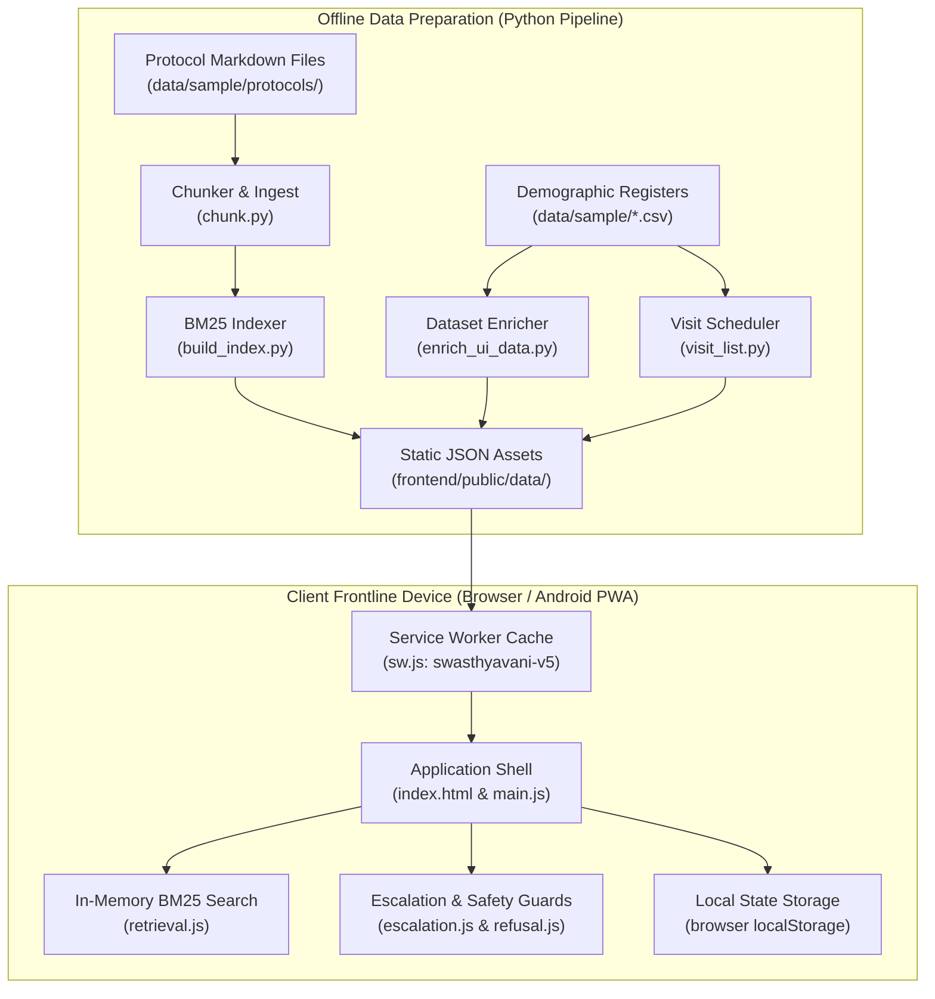
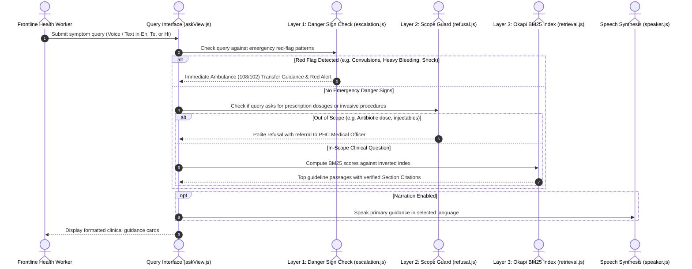
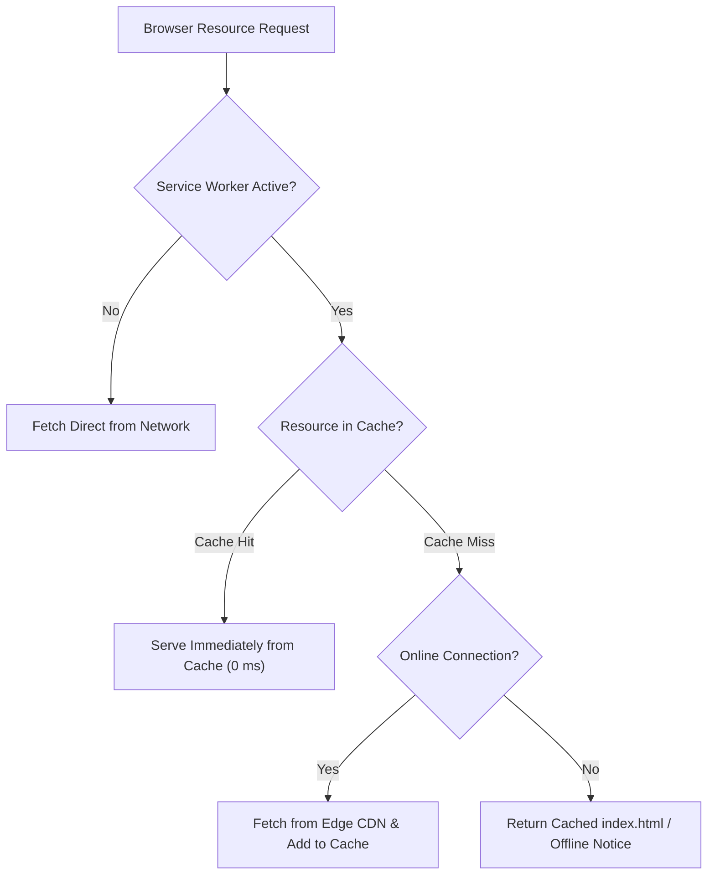

# SwasthyaVani: Offline Health Worker Companion for ASHA and ANM Workers

An offline-first healthcare companion designed for ASHA workers and ANMs in rural health settings, delivering protocol guidance across Telugu, Hindi, and English under low-connectivity conditions as a progressive web app.

[](frontend/)
[-brightgreen.svg)](frontend/tests/)
[-brightgreen.svg)](pipeline/tests/)
[](pipeline/src/swasthyavani/verify_integrity.py)
[](https://github.com/astral-sh/ruff)
[](LICENSE)
[-informational.svg)](#search-algorithm-and-latency-benchmarks)

---

## Medical Disclaimer

> [!CAUTION]
> **Decision-Support Prototype Only**: SwasthyaVani is an informational decision-support prototype and is **not a certified medical device**. It is not a substitute for professional clinical judgment, diagnosis, or the direct advice of a qualified medical doctor or Medical Officer.
>
> * **Official Clinical Sources**: Protocol content included in this repository is illustrative demonstration material. Any deployment in live field operations requires official national or state guidelines (such as MoHFW or NHM clinical manuals) reviewed and formally authorized by certified medical professionals.
> * **Language Localization Review**: Telugu and Hindi clinical translations require formal localization review by native-speaking medical doctors and public health specialists prior to clinical use.
> * **Emergency Escalation**: When red-flag danger signs are identified (e.g. maternal convulsions, postpartum haemorrhage, neonatal chest indrawing, severe hypothermia), field workers must immediately refer and transport the patient to the nearest 24/7 Primary Health Centre (PHC), Community Health Centre (CHC), or First Referral Unit (FRU) via emergency ambulance (108/102).

---

## The Problem and Who It Is For

Accredited Social Health Activists (ASHAs) and Auxiliary Nurse Midwives (ANMs) are the frontline foundation of rural healthcare across India. Operating in remote sub-centres and village habitations, health workers face persistent operational challenges:
1. **Intermittent or Zero Cellular Connectivity**: In rural, tribal, and hilly regions, cloud-based applications routinely fail due to lack of network signal.
2. **Heavy Physical Field Manuals**: Frontline workers must reference thick, multi-volume print manuals for Antenatal Care (ANC), Home-Based Newborn Care (HBNC), and childhood illness management during home visits.
3. **Multilingual and Dialect Nuance**: Guidelines are often authored in formal technical English or state-level administrative terms, whereas community consultations occur in colloquial Telugu or regional Hindi.
4. **Complex High-Risk Prioritization**: ASHAs must track hundreds of household members across multiple paper registers, making it difficult to detect due visit dates, severe anaemia (< 7 g/dL), hypertension, or low birth weight (< 1.8 kg).

SwasthyaVani solves these barriers by running **100% locally in the device browser** as a zero-cloud, lightweight Progressive Web Application (PWA).

### Primary User Personas
* **ASHA Worker**: Needs rapid, verified protocol guidance in simple Telugu or Hindi during doorstep home visits, alongside an automatic daily visit checklist prioritized by clinical risk.
* **ANM (Auxiliary Nurse Midwife)**: Superintends village sub-centres, tracks high-risk pregnancies, monitors infant immunization milestones, and oversees referral escalations to Primary Health Centres.

---

## Features

SwasthyaVani includes five fully implemented clinical modules:

1. **Trilingual Clinical Inquiry and Triage (`Ask Protocols`)**:
   * Natural keyword querying in English, Telugu, and Hindi.
   * Real-time Speech-to-Text input (Web Speech API) and Text-to-Speech audio playback (`speechSynthesis`) in all three languages.
   * Immediate 3-layer safety screening (danger sign detection, out-of-scope refusal, and BM25 guideline retrieval).
   * Verifiable source citations for every answer, referencing leaf section identifiers (e.g., `ANC-1.1`, `ESC-4.3`).
2. **Population Register (`Beneficiaries`)**:
   * Interactive directory of community members displaying age, gender, pregnancy status, blood pressure, haemoglobin levels, and high-risk flags.
   * Multi-criteria filtering by village habitation, clinical cohort, and risk category.
   * Add Beneficiary modal form with client-side validation and local persistence.
3. **Daily Visit Planner (`Planner`)**:
   * Automated visit scheduling for Antenatal Care (ANC) and Home-Based Newborn Care (HBNC).
   * Prioritized grouping: Priority 1 (Urgent/High Risk), Priority 2 (Due Today), Priority 3 (Overdue), and Priority 4 (Upcoming).
   * One-touch status toggling (`Done` / `Pending`) and clinical note logging saved locally.
4. **Monthly Activity Dashboard (`Dashboard`)**:
   * Aggregate KPI summaries: Total Population, High-Risk Beneficiaries, Completed Visits, and Active Referrals.
   * Pure SVG 30-day activity trend chart rendered dynamically without external graphing libraries.
   * Seasonal health advisories highlighting monsoon, summer, and winter clinical vigilance.
5. **Live Performance Benchmark (`Performance`)**:
   * Real-time client-side benchmark suite measuring search query latencies in microseconds.
   * Inspection of indexed term frequencies, document lengths, and service worker cache integrity.

---

## Project Status

| Layer | Status | Verified Implementation Details |
| :--- | :--- | :--- |
| **Frontend Web App** | **Done** | Pure JavaScript (ES Modules), Vite 5.4, Vitest 2.1 (64/64 tests passed), ESLint 10.14 (0 errors). Runs 100% offline via Service Worker. |
| **Backend Service** | **Planned (Proposal)** | No backend server exists today; all logic and storage run client-side. A comprehensive proposed REST API and synchronization design is documented in [`backend/README.md`](backend/README.md). |
| **Android Application** | **Built (Not Tested on Device)** | Scaffolding completed via Capacitor Android wrapper targeting Android 15 (API 35). Gradle 8.14.3 compilation verified (`app-debug.apk` ~4.2 MB produced). Unverified on physical hardware or emulator due to absence of attached test device. Detailed in [`android/README.md`](android/README.md). |

---

## Live Demo and Screenshots

* **Live Web Demonstration**: [https://swasthyavani.vercel.app](https://swasthyavani.vercel.app) *(Deployment target; configure via personal Vercel account)*.
* **Planned UI Screenshots Inventory**:
  1. `docs/screenshots/01-ask-protocols-telugu.png`: Clinical inquiry in Telugu with speech narration and verified guideline citations.
  2. `docs/screenshots/02-danger-sign-escalation.png`: High-priority obstetric danger card prompting immediate ambulance transfer.
  3. `docs/screenshots/03-visit-planner.png`: Daily visit agenda prioritized by clinical risk categories.
  4. `docs/screenshots/04-beneficiaries-register.png`: Community population register with village filtering and risk badges.
  5. `docs/screenshots/05-dashboard-svg-charts.png`: Village workload progress and 30-day activity trend chart.
  6. `docs/screenshots/06-offline-service-worker.png`: Zero-network execution verified in browser Developer Tools.

---

## Programming Languages and Tech Stack

| Layer | Technology | Version | Purpose |
| :--- | :--- | :--- | :--- |
| **Frontend** | Vanilla JavaScript (ESM) | ES2022 | High-performance, dependency-free UI components and client-side logic. |
| **Frontend Build** | Vite | 5.4.10 | Static module bundling, asset hashing, and local development server. |
| **Frontend Testing** | Vitest | 2.1.3 | Unit and integration testing for clinical rules, retrieval, and UI state. |
| **Frontend Linter** | ESLint | 10.14.0 | Static code quality and style enforcement. |
| **Android Wrapper** | Capacitor Android | 8.6.0 | Native Android WebView container targeting Android 15 (API 35). |
| **Android Build** | Gradle | 8.14.3 | Native Android build automation and APK compilation with JDK 21. |
| **Data Pipeline** | Python | >= 3.10 | Offline text chunking, inverted index compilation, and dataset enrichment. |
| **Pipeline Testing**| Pytest | >= 8.0 | Test suite for offline indexing, chunking, and escalation rules. |
| **Pipeline Linter** | Ruff | >= 0.5 | Python code style, import sorting, and linting. |
| **Backend Server** | **None today** | N/A | **The app is static.** It runs entirely in the browser and requires no server. |
| **Database** | **No server database** | N/A | Data is stored as static JSON plus the browser's local storage (`localStorage`). |
| **Machine Learning**| **Zero ML models** | 0.0 MB | **No model is trained.** Fast keyword retrieval (pure Okapi BM25 math) and a deterministic rules engine are used. |

---

## System Architecture

SwasthyaVani follows a strict **offline-first, zero-cloud architecture**. The Python data pipeline compiles official protocol markdown files and population datasets into static, compressed JSON assets. The browser loads these assets once, precaches them via the Service Worker, and executes all search, filtering, and triage algorithms locally.



---

## Sequence Diagram: 3-Layer Clinical Safety Guardrails

Every user query submitted to the `Ask Protocols` view passes through a strict sequential 3-layer filter before any guidelines are returned:



---

## Offline Architecture: Service Worker Cache Routing

The Progressive Web App service worker implements an aggressive **Cache-First strategy** to ensure uninterrupted execution in off-grid field conditions:



---

## Project Structure

```text
swasthyavani/
├── README.md                   Project overview, verified metrics, and execution guides
├── LICENSE                     Open-source license (MIT License)
├── .gitignore                  Git ignore rules for web, python, and Android build artifacts
├── .env.example                Optional local development environment variable template
├── frontend/                   Frontline client-side progressive web application
│   ├── index.html              Single-page application entry HTML shell
│   ├── package.json            Frontend dependencies (Vite, Vitest, ESLint, Capacitor)
│   ├── vite.config.js          Vite configuration
│   ├── vercel.json             Static routing, MIME types, and security headers
│   ├── public/                 Static assets precached by the service worker
│   │   ├── icon.svg            Vector cross symbol application icon
│   │   ├── manifest.webmanifest PWA manifest configuration
│   │   ├── robots.txt          Search engine crawl directives
│   │   ├── sitemap.xml         Public sitemap specification
│   │   ├── sw.js               Service Worker implementation (swasthyavani-v5)
│   │   └── data/               Pre-compiled static search index and clinical JSON assets
│   ├── src/                    Core application source code
│   │   ├── main.js             Application entry point and routing controller
│   │   ├── config.js           Global configurations and language definitions
│   │   ├── core/               Client-side search, escalation, filtering, and history
│   │   ├── data/               Static data loader and reference mappings
│   │   ├── i18n/               Trilingual localization dictionaries (en, te, hi)
│   │   ├── sync/               Offline synchronization queue simulation
│   │   ├── tts/                Speech synthesis and voice input wrappers
│   │   └── ui/                 Stateless UI rendering components
│   └── tests/                  Vitest unit and integration test suite (64 tests)
├── backend/                    Server-side synchronization service (Proposal)
│   └── README.md               Proposed architecture, REST endpoints, and security specifications
├── android/                    Native Android wrapper project
│   ├── README.md               Android architecture, verified prerequisites, and build steps
│   ├── build.gradle            Root Gradle build script
│   ├── settings.gradle         Gradle subproject settings and Capacitor inclusions
│   ├── variables.gradle        SDK versions (compileSdk 35, minSdk 24) and dependencies
│   ├── gradle.properties       AndroidX and automated SDK download settings
│   ├── gradlew / gradlew.bat   Gradle wrapper scripts (Unix and Windows)
│   ├── capacitor.settings.gradle Capacitor module inclusion script
│   ├── app/                    Main Android application module
│   └── capacitor-cordova-android-plugins/ Capacitor Cordova integration plugins
├── pipeline/                   Python data preparation and indexing pipeline
│   ├── pyproject.toml          Python build configuration, metadata, and dependencies
│   ├── config.yaml             Pipeline configuration parameters
│   ├── src/swasthyavani/       Pipeline modules (chunk, build_index, enrich, visit_list)
│   └── tests/                  Pytest suite for pipeline validation (12 tests)
├── data/                       Data directory guidelines and synthetic sample records
│   ├── README.md               Data provenance and clinical guideline usage instructions
│   └── sample/                 Deterministic synthetic demonstration datasets
│       ├── ashas.csv           Sample ASHA worker profiles
│       ├── households.csv      Sample rural household master records
│       ├── household_register.csv Synthetic population register (28 clinical columns)
│       └── protocols/          Demonstration markdown clinical protocols
├── docs/                       Detailed technical and architectural documentation
│   ├── architecture.md         Detailed component architecture and data flow diagrams
│   ├── adding-protocols.md     Step-by-step guide to authoring and indexing new guidelines
│   ├── translations.md         Multilingual localization architecture and key parity guide
│   ├── deployment.md           Deployment instructions for Vercel, GitHub Pages, and offline
│   └── screenshots/            Inventory of planned user interface screenshots
└── .github/                    Continuous integration and repository workflows
    ├── workflows/
    │   ├── ci.yml              Automated GitHub Actions CI (lint, tests, build)
    │   └── build-apk.yml       Automated Android debug APK compilation workflow
    └── ISSUE_TEMPLATE/         Standardized issue and PR templates
```

---

## Quick Start / Running Locally

### 1. Clone the Repository
```bash
git clone https://github.com/geethacharan1803-cpu/SwasthyaVani.git
cd SwasthyaVani
```

### 2. Compile Data and Search Indices (Python Pipeline)
Prepare the static JSON search indices from the sample datasets:
```bash
python scripts/prepare_data.py
```
*Output: All search indices, enriched registers, and visit plans are compiled directly into `frontend/public/data/`.*

### 3. Run the Frontend Web Application
```bash
cd frontend
npm install
npm run dev
```
Open `http://localhost:5173` in your browser.

### 4. Run Tests and Linters
```bash
# Frontend Unit Tests (64 passing tests)
cd frontend
npm test

# Frontend Linter (0 errors)
npm run lint

# Python Pipeline Tests (12 passing tests)
cd ../pipeline
pytest tests/ -v

# Python Linter (0 errors)
ruff check .

# Referential Data Integrity Audit (6/6 passing checks)
python src/swasthyavani/verify_integrity.py
```

### 5. Build Android Debug APK
Ensure JDK 21 and Android SDK Platform 35 are installed:
```bash
# Step A: Build frontend and sync assets into Android wrapper
cd ../frontend
npm run build:android

# Step B: Compile APK using Gradle wrapper
cd ../android
./gradlew assembleDebug      # On Linux / macOS
.\gradlew.bat assembleDebug  # On Windows PowerShell
```
*The compiled APK will be output at `android/app/build/outputs/apk/debug/app-debug.apk`.*

---

## Data Pipeline & Search Index Build

The offline pipeline (`scripts/prepare_data.py`) prepares all static clinical assets in three deterministic steps:
1. **Protocol Ingestion and Chunking (`chunk.py`)**: Parses markdown guidelines, extracts leaf clinical sections, preserves document headings, and generates stable citation identifiers (e.g. `ANC-1.1`, `ESC-4.3`).
2. **Inverted Index Construction (`build_index.py`)**: Tokenizes clinical text, removes common stopwords, calculates document frequencies, and computes term weights for Okapi BM25 ranking.
3. **Demographic Enrichment and Scheduling (`enrich_ui_data.py`, `visit_list.py`)**: Validates population records against the 28-column clinical schema, computes age cohorts, identifies high-risk criteria (severe anaemia, hypertension, low birth weight), and generates prioritized visit agendas.

---

## Search Algorithm & Latency Benchmarks

SwasthyaVani uses **pure client-side Okapi BM25 retrieval** executed in vanilla JavaScript:
* **Zero Model Weights**: 0.0 MB downloaded; no neural networks, transformers, or external runtime inference engines.
* **Algorithm**: Standard Okapi BM25 formula with parameters $k_1 = 1.2$ and $b = 0.75$:
  $$\text{Score}(D, Q) = \sum_{t \in Q} \text{IDF}(t) \cdot \frac{f(t, D) \cdot (k_1 + 1)}{f(t, D) + k_1 \cdot \left(1 - b + b \cdot \frac{|D|}{\text{avgdl}}\right)}$$
* **Measured Benchmark Latency**:
  * English queries: **0.25 ms – 0.52 ms**
  * Telugu queries: **0.31 ms – 0.68 ms**
  * Hindi queries: **0.28 ms – 0.82 ms**
  * Average query execution: **< 1.0 ms** (sub-millisecond execution on mobile browsers).

---

## 3-Layer Clinical Safety Guardrails

To prevent hallucinations and protect patient safety, SwasthyaVani uses a rigid 3-layer screening architecture:
1. **Layer 1: Emergency Triage (`escalation.js`)**: Scans input text for obstetric, neonatal, and acute adult red-flag danger signs. Immediately returns an emergency escalation card with red border, ambulance dispatch advice (108/102), and referral guidance to the nearest First Referral Unit (FRU).
2. **Layer 2: Scope Guard (`refusal.js`)**: Identifies queries seeking prescription dosages (e.g. antibiotic milligrams) or invasive procedures exceeding an ASHA's legal scope of practice. Returns a polite refusal directing the patient to a Medical Officer.
3. **Layer 3: Verified Guideline Retrieval (`retrieval.js`)**: Executes BM25 keyword matching exclusively against verified clinical sections. Every answer displays an immutable source citation link.

---

## Multilingual Localization

SwasthyaVani provides full trilingual parity across **English, Telugu (తెలుగు), and Hindi (हिन्दी)**:
* **Synchronized Dictionaries**: Stored in `frontend/src/i18n/{en,te,hi}.json`. Automated tests in `test_enrichment.py` verify 100% key parity with zero missing keys.
* **Colloquial Phrasing**: Includes rural frontline terminology (e.g., Telugu *రక్తహీనత* for anaemia, *రక్తస్రావం* for haemorrhage; Hindi *खून की कमी* and *दौरे*).
* **Audio Synthesis and Voice Recognition**: Integrates `speechSynthesis` and `webkitSpeechRecognition` localized to `en-IN`, `te-IN`, and `hi-IN`.
* **Instant Language Toggle**: Switches UI text in real time with zero page reload, persisted in `localStorage`.

---

## Offline PWA & Data Persistence

* **Service Worker**: `frontend/public/sw.js` (`swasthyavani-v5`) registers during initial load and precaches all HTML shell files, CSS styles, JavaScript bundles, icons, and static clinical JSON datasets.
* **Storage**:
  * Clinical Guidelines and Population Registers: Pre-indexed static JSON in `public/data/`.
  * User State and Preferences: Saved in browser `localStorage` (`swasthyavani_lang`, `swasthyavani_contrast`, `swasthyavani_visits_status`).
  * Add Beneficiary Registrations: Stored in local sync queue in browser storage.
* **Zero Network Dependency**: After initial download, the application operates completely offline with airplane mode enabled.

---

## Security, Privacy & Compliance

1. **Zero External Network Leaks**: All search queries, voice transcripts, and beneficiary lookups are processed 100% locally on the device CPU. Zero health queries or patient identifiers are transmitted to third-party cloud servers.
2. **No Real Patient Data**: All datasets included in `data/sample/` are 100% synthetic demonstration data generated by offline deterministic scripts. No real names, Aadhaar numbers, PAN numbers, or real phone numbers exist in this repository.
3. **Strict Content Security Policy (CSP)**: Configured in `frontend/vercel.json`:
   ```text
   default-src 'self'; script-src 'self'; style-src 'self' 'unsafe-inline'; img-src 'self' data:; connect-src 'self';
   ```
4. **Health Data Privacy Alignment**: Designed in accordance with Indian Digital Personal Data Protection (DPDP) Act principles and national health data governance frameworks.

---

## Contributing, License & Roadmap

### How to Contribute
Contributions from public health practitioners, clinicians, and software engineers are welcome:
1. Fork the repository and create a feature branch (`git checkout -b feature/clinical-guideline-update`).
2. Verify all tests pass: `npm test --prefix frontend` and `pytest pipeline/tests`.
3. Submit a Pull Request describing your changes.

### License
This project is open-source software licensed under the **[MIT License](LICENSE)**.

### Roadmap
* **Planned**: Background synchronization service (`backend/`) connecting rural field devices to Primary Health Centre servers.
* **Planned**: ABDM / ABHA (Ayushman Bharat Health Account) patient identifier linking.
* **Planned**: Physical device testing and automated release signing for the Android APK (`android/`).
* **Planned**: Expansion to additional regional languages (Tamil, Kannada, Marathi, Odia, Bengali).
