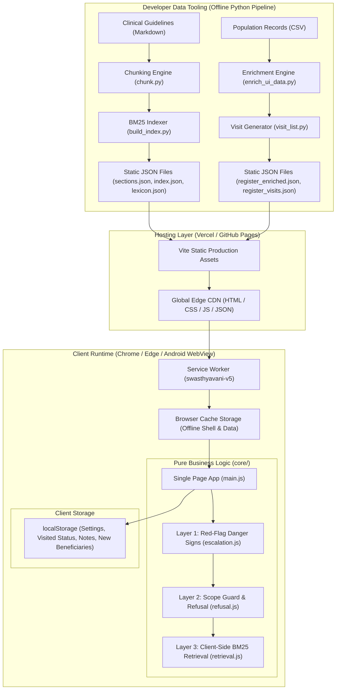
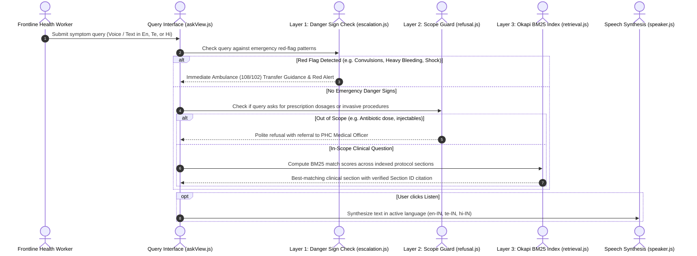
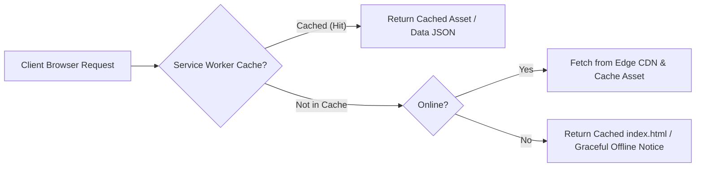

# SwasthyaVani System Architecture

SwasthyaVani is engineered strictly as a **zero-server, offline-first progressive web application (PWA)** for community health workers (ASHAs and ANMs) in low-connectivity rural settings.

---

## 1. High-Level Architecture

The system decouples developer data preparation from client runtime execution:

---

## 2. Clinical Question Flow & Multi-Layer Triage

When a frontline worker enters a query (via text or voice), it passes through a 3-layer deterministic decision pipeline:

---

## 3. Offline Caching Flow

---

## 4. Frontend Component Architecture

All UI components in `frontend/src/ui/` are stateless render functions driven by events and state passed from `frontend/src/main.js`:
- `header.js`: Top navigation, language selection toggle, high-contrast toggle, online/offline badge.
- `askView.js`: Voice and text search inputs, sample query chips by clinical program, trilingual audio narration controls.
- `registerView.js`: Beneficiary table, cascading filters (village, cohort, risk), beneficiary details modal.
- `registrationView.js`: Add Beneficiary modal form with client-side validation.
- `visitListView.js`: Scheduled visit cards grouped by priority (Urgent, Due today, Overdue, Upcoming), village route grouping, visit status toggle (`Done` / `Pending`), note entry modal.
- `dashboardView.js`: Pure SVG 30-day activity trend chart, program breakdown, village workload progress.
- `performanceView.js`: Client-side benchmark suite reporting live query latencies and offline status.

